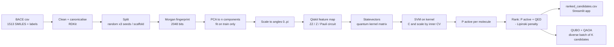

# Architecture

QuantumScreen is a **hybrid quantum-classical** pipeline. Classical software (RDKit, scikit-learn) prepares
molecules and handles optimisation; Qiskit provides the quantum circuits that turn a molecule's feature vector
into a quantum state and measure similarity between states.

## 1. Data flow



A parallel branch trains classical baselines (RBF-SVM, Random Forest) on the *same* splits and the same PCA
features, so any difference is attributable to the model, not the data.

A selection stage (`selection.py`) takes the top-ranked shortlist and chooses a batch of K mutually dissimilar candidates with a QUBO solved by QAOA, compared with classical solvers.

A separate module (`vqe.py`) demonstrates the quantum-chemistry side: VQE ground-state energies of H2 and LiH.

## 2. Repository layout

```
quantumscreen/
├── main.py                  CLI entry point (stages: benchmark, screen, vqe, figures)
├── app.py                   Streamlit demo UI
├── requirements*.txt        pinned dependencies (core / dev / VQE extras)
├── data/bace.csv            BACE-1 dataset (MoleculeNet), columns mol, CID, Class, Model, pIC50
├── src/quantumscreen/
│   ├── config.py            all hyper-parameters (Config dataclass)
│   ├── data.py              load/clean, stratified + scaffold splits
│   ├── features.py          Morgan fingerprints, drug-likeness, QuantumEncoder (PCA -> angles)
│   ├── quantum.py           feature maps, statevector kernel, QuantumKernelSVM, VQC
│   ├── classical.py         RBF-SVM and Random Forest baselines
│   ├── metrics.py           AUC/F1/..., enrichment factor, precision@k
│   ├── benchmark.py         experiment harness (main benchmark, ablations, scaffold, VQC)
│   ├── ranking.py           combined candidate score
│   ├── pipeline.py          final screen, model save/load, screen_smiles()
│   ├── selection.py         diversity-aware QUBO + QAOA candidate selection, classical solvers, experiments
│   ├── vqe.py               VQE potential-energy curves (Qiskit Nature)
│   └── plots.py             all figures
├── tests/                   pytest suite
├── notebooks/               end-to-end walkthrough notebook
├── results/                 CSV tables, JSON summary, figures
├── models/                  trained model artefacts (joblib)
├── docs/                    this documentation
└── report/, slides/         project report and presentation
```

## 3. Key design decisions

| Decision | Why |
|---|---|
| **Exact statevector kernel** instead of a per-pair sampler | The kernel `k(x,x') = abs(<phi(x)|phi(x')>)^2` is computed from each sample's statevector once (N circuits) instead of running N^2/2 overlap circuits. Results match Qiskit ML's `FidelityQuantumKernel` to ~1e-12 (verified in `tests/test_quantum.py`) and let us use the whole 1513-molecule dataset in seconds. |
| **PCA and scaler fitted on the training split only** | Prevents test-set leakage into the encoder. |
| **Inner cross-validation for (C, scale)** | Hyper-parameters never see the test set; the classical SVM gets the same tuning budget (fairness). |
| **Repeated random splits + one scaffold split** | Random splits give mean +/- std; the scaffold split tests generalisation to unseen chemotypes, the realistic screening scenario. |
| **Soft Lipinski penalty, not a hard filter** | Borderline molecules are de-prioritised rather than discarded. On BACE ~95 % of actives pass the rule (see `results/screening_summary.json`), so the penalty rarely changes the ranking; QED has the larger effect. |
| **No experimental affinity in the score** | Using measured pIC50 of the candidates would leak the answer into the screening; the score uses only model output, QED and Lipinski. |
| **Pairwise (diversity) term in the selection QUBO** | Without it the K-of-N problem is solved exactly by sorting, so QAOA would solve a problem that needs no optimiser. |
| **Random-search and output-quality controls for QAOA** | At N ≤ 14 "best of 1024 shots" is matched by random sampling; comparing the whole output distribution with random feasible subsets is the honest test. |
| **`z` feature map as a control** | It has no entanglement and is trivially simulable classically; comparing it with entangling maps shows whether entanglement helps. |
| **VQC on a small subset** | VQC training needs many circuit evaluations per optimiser step, so it is compared against the other models on the same small training set. |

## 4. Reproducibility

* All randomness is seeded (`Config.seeds`, scikit-learn `random_state`, `algorithm_globals.random_seed`).
* Dependency versions are pinned in `requirements.txt`.
* `python main.py` regenerates every table and figure in `results/`.
