# Results

All numbers below are produced by `python main.py` and stored in `results/` (CSV/JSON). Random-split results are the
mean ± standard deviation over **3 seeds** (0, 1, 2) on the full dataset of 1513 BACE molecules (80/20 stratified splits).
The quantum circuits are simulated exactly (noiseless statevectors).

## 1. Headline comparison (random split, 8 qubits / 8 PCA components)

| Model | ROC-AUC (mean ± std) | Accuracy | F1 | EF@10% | Fit time (s) |
|---|---|---|---|---|---|
| Random Forest (2048-bit FP) | 0.916 ± 0.006 | 0.834 | 0.817 | 2.1 | 1.7 |
| Classical SVM (RBF, PCA-8) | 0.879 ± 0.007 | 0.806 | 0.784 | 1.98 | 4.4 |
| Random Forest (PCA-8) | 0.877 ± 0.015 | 0.807 | 0.785 | 2.07 | 0.8 |
| Quantum Kernel SVM (zz, reps=2, 8q) | 0.873 ± 0.011 | 0.794 | 0.772 | 2.07 | 11.1 |

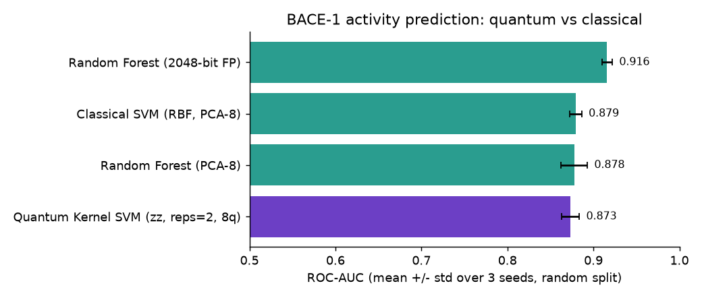

**Reading.** The quantum-kernel SVM and the classical RBF-SVM that sees the *same* 8 features are statistically
indistinguishable (AUC 0.873 vs 0.879; the gap is smaller than one standard deviation of either). Neither beats a Random
Forest on the full 2048-bit fingerprint (0.916), which keeps far more information. The quantum model needs ~2.5x longer to fit
because it is simulated on a classical CPU. **We observe no quantum advantage on this task.**

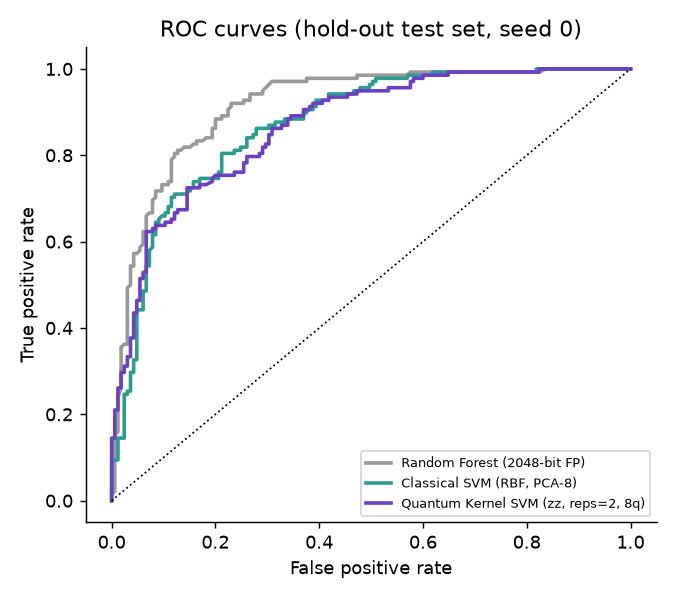

## 2. Feature-map ablation

| Feature map (8 qubits) | ROC-AUC | EF@10% |
|---|---|---|
| zz_full (reps 2) | 0.881 ± 0.017 | 2.0 |
| z (reps 2) | 0.877 ± 0.009 | 2.02 |
| zz (reps 1) | 0.874 ± 0.012 | 2.0 |
| zz (reps 2) | 0.873 ± 0.011 | 2.07 |
| pauli_yzz (reps 2) | 0.869 ± 0.013 | 1.98 |

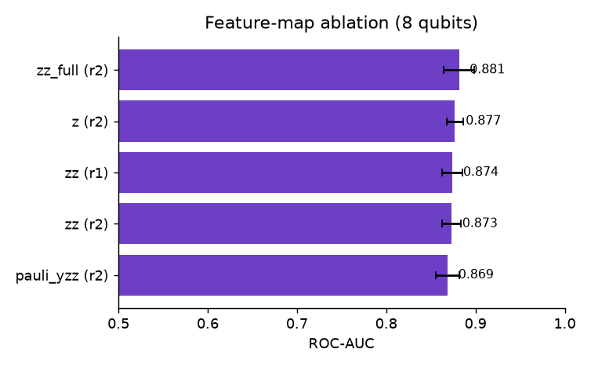

All five circuits fall within 0.012 AUC of each other, which is inside the seed-to-seed noise. The **un-entangled `z` map
(0.877) scores the same as the entangling `zz` maps**, so on this data entanglement is not what drives performance.

## 3. Number of qubits

| Qubits | Quantum kernel SVM (zz) | Classical RBF SVM | Quantum fit (s) | Classical fit (s) |
|---|---|---|---|---|
| 4 | 0.837 ± 0.011 | 0.843 ± 0.010 | 5.7 | 4.4 |
| 6 | 0.854 ± 0.023 | 0.882 ± 0.012 | 7.9 | 4.3 |
| 8 | 0.873 ± 0.011 | 0.879 ± 0.007 | 11.1 | 4.4 |
| 10 | 0.867 ± 0.021 | 0.880 ± 0.007 | 15.7 | 4.6 |

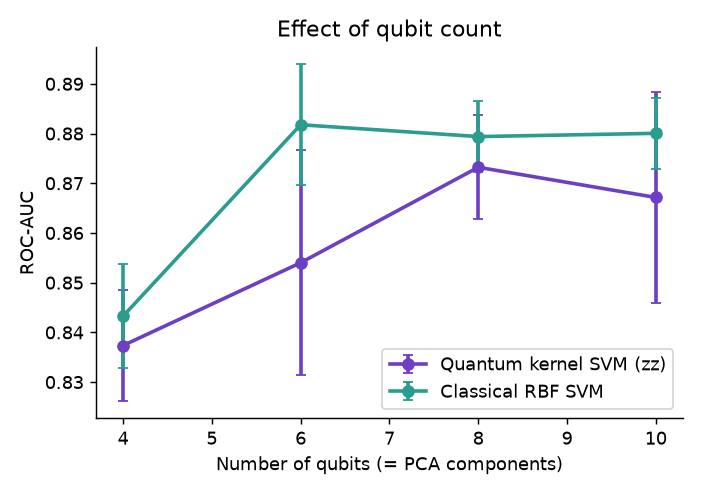

Performance rises from 4 to 8 qubits for both model families and then plateaus. The classical SVM is at least as good as the quantum
kernel at every qubit count; the gap closes at 8 qubits. Keeping only 8 PCA components retains about 36 % of the fingerprint variance
(training split), which explains why all 8-feature models sit below the full-fingerprint Random Forest.

## 4. Generalisation to new chemotypes (scaffold split)

| Model | Random split AUC | Scaffold split AUC | Scaffold EF@10% |
|---|---|---|---|
| Random Forest (2048-bit FP) | 0.916 | 0.781 | 1.49 |
| Random Forest (PCA-8) | 0.877 | 0.707 | 1.32 |
| Classical SVM (RBF, PCA-8) | 0.879 | 0.667 | 1.61 |
| Quantum Kernel SVM (zz, reps=2, 8q) | 0.873 | 0.677 | 1.61 |

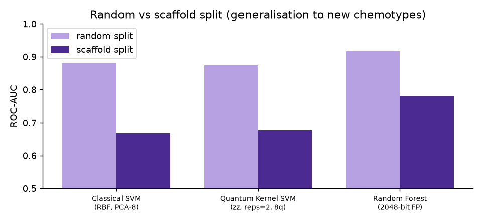

When the test molecules have scaffolds not present in training, every model degrades substantially (AUC drops by 0.13 - 0.21).
Quantum and classical SVMs again perform alike (0.677 vs 0.667). This is a single deterministic split, so no standard
deviation is available, and the small differences between models should not be over-interpreted.

## 5. Variational quantum classifier (VQC)

| Model (200 training molecules, 6 qubits) | ROC-AUC | F1 | Fit time (s) |
|---|---|---|---|
| Classical SVM (RBF, PCA-6) | 0.828 ± 0.031 | 0.738 | 0.3 |
| Quantum Kernel SVM (zz, reps=2, 6q) | 0.811 ± 0.008 | 0.725 | 1.3 |
| VQC (ZZ r1 + RealAmplitudes, 6q) | 0.625 ± 0.056 | 0.548 | 119.0 |

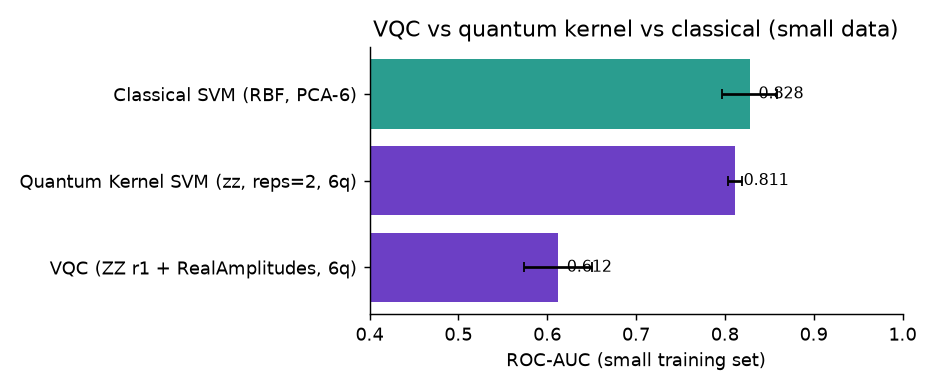

The VQC (ZZ feature map + RealAmplitudes ansatz, COBYLA, 120 iterations, 3 seeds) is clearly worse than the
quantum kernel SVM and ~90x slower to train. It was not hyper-parameter tuned and is probably under-trained,
so this shows the practical cost of variational training rather than a fundamental limit.

## 6. Virtual screening of a hold-out library

A model trained on 80 % of BACE ranks the unseen 20 % (303 molecules, 45.5% truly active).

| Ranking | Precision@25 | EF@10% |
|---|---|---|
| Quantum kernel SVM score | 0.96 | 2.12 |
| Classical RBF-SVM score | 0.84 | 1.90 |
| **Final score** (0.7·quantum P(active) + 0.3·QED − Lipinski penalty) | 0.92 | 1.90 |

The maximum possible EF@10% for this library is 2.20. The quantum score places 24 actives in its top 25 and
the final (drug-likeness-adjusted) ranking places 23. **Caution:** this is one split and the top-25 difference between quantum (24/25)
and classical (21/25) is three molecules - suggestive but not statistically significant. The more reliable comparison is the 3-seed EF@10% in section 1
(quantum 2.07, classical SVM 1.98, Random Forest 2.10). Adding QED trades a little hit-rate for more drug-like shortlists. The Lipinski rule barely
discriminates in this dataset (95% of actives and 97% of inactives pass).

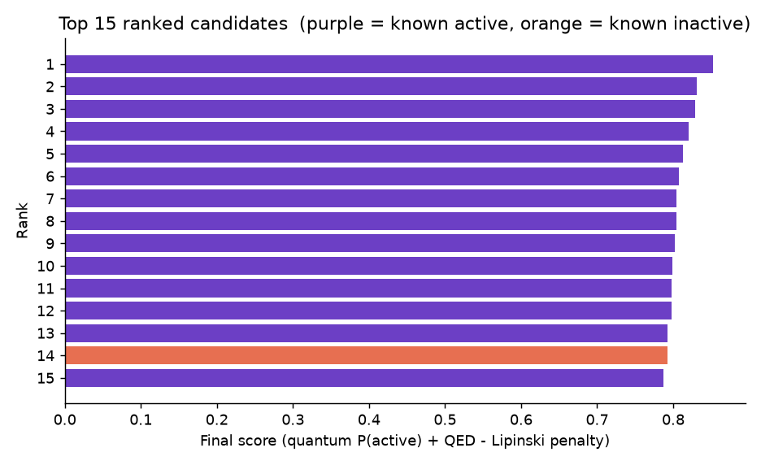
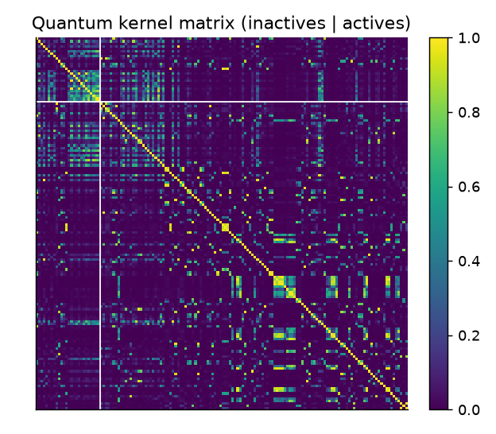

The full ranked list is in `results/ranked_candidates.csv`. The kernel matrix shows that most molecule pairs are nearly orthogonal in the quantum feature space
(bright only on the diagonal and for similar molecules), a known "kernel concentration" effect; cross-validation therefore picks a small angle scale
(0.25).

## 7. VQE (quantum chemistry demo)

| Molecule | Qubits | Parameters | Bond lengths | Max abs. error vs exact (mHa) | HF error at equilibrium (mHa) |
|---|---|---|---|---|---|
| H2 | 2 | 3 | 12 | 0.0002 | 20.5 |
| LiH (active space) | 4 | 8 | 8 | 0.0003 | 19.2 |

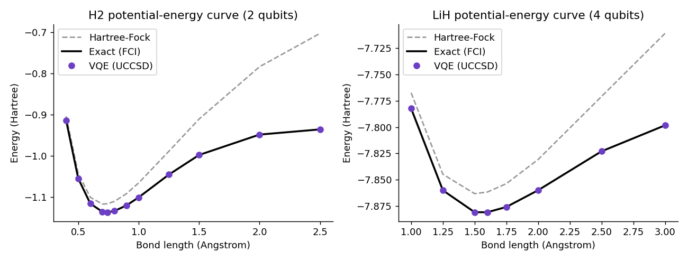

VQE with a UCCSD ansatz reproduces the exact ground-state energy to far better than chemical accuracy (1.6 mHa) at every bond length
and recovers the correlation energy that Hartree-Fock misses (e.g. 233 mHa at 2.5 Å for H2).
The H2 equilibrium energy (−1.137 Ha at 0.74 Å) matches the literature STO-3G value. These are noiseless statevector simulations with
exact expectation values, so near-zero error is expected; real hardware would add shot noise and gate errors.

## 8. Diversity-aware candidate selection with QAOA

The lab can advance only K of N shortlisted molecules. We choose K candidates maximising
`J(x) = Σ sᵢxᵢ − λ Σ Sᵢⱼ xᵢxⱼ` (screening score minus Tanimoto redundancy, λ = 0.5; **no experimental affinity is used**), solved by
QAOA (Qiskit, noiseless statevector, p = 1-3) and compared with classical solvers. Each cell is the mean over 8 random shortlists drawn from the top-40 of the
hold-out ranking (K = N/3 rounded, at least 3).

| Method (objective / exact optimum) | N=8 | N=10 | N=12 | N=14 |
|---|---|---|---|---|
| Top-K by score | 0.921 | 0.907 | 0.886 | 0.779 |
| Random feasible subset | 0.894 | 0.887 | 0.837 | 0.830 |
| Greedy (diversity-aware) | 0.999 | 0.999 | 1.000 | 0.998 |
| QAOA p=1 (best feasible of 1024 shots) | 1.000 | 1.000 | 0.993 | 0.996 |
| QAOA p=2 (best feasible of 1024 shots) | 1.000 | 1.000 | 0.998 | 0.986 |
| QAOA p=3 (best feasible of 1024 shots) | 1.000 | 1.000 | 0.999 | 0.993 |
| Random search, 1024 shots | 1.000 | 1.000 | 1.000 | 0.998 |

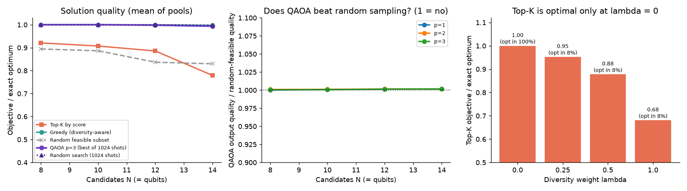

**Reading.**
* The QUBO is not trivial: score-only top-K reaches only 78-92 % of the optimum, and falls with N. With λ = 0 top-K is exactly optimal (100 % of pools) but for λ > 0 it almost never is:

| Diversity weight λ | Top-K objective / optimum | Top-K exactly optimal in |
|---|---|---|
| 0.0 | 1.00 | 100% |
| 0.25 | 0.95 | 8% |
| 0.5 | 0.88 | 8% |
| 1.0 | 0.68 | 8% |

* QAOA's *best feasible sample* reaches 99-100 % of the optimum, and a **diversity-aware classical greedy** does the same. But **random search with the same 1024 shots does equally well**, because the search spaces are small (56 to 1001 feasible subsets).
* The honest diagnostic is the quality of QAOA's whole output distribution:

| N (qubits) | Feasible subsets | QAOA feasible mass (p=3) | QAOA P(optimal) | Uniform over feasible | QAOA output quality / random | Runtime per run (s) |
|---|---|---|---|---|---|---|
| 8 | 56 | 0.52 | 0.0092 | 0.0179 | 1.001 | 1.6 |
| 10 | 120 | 0.40 | 0.0034 | 0.0083 | 1.001 | 2.5 |
| 12 | 495 | 0.38 | 0.0008 | 0.0020 | 1.001 | 4.3 |
| 14 | 1001 | 0.33 | 0.0003 | 0.0010 | 1.002 | 10.8 |

QAOA's output quality is 1.00x that of random feasible subsets, and its probability on the optimum is at or below uniform sampling of feasible subsets (0.0003 vs 0.001 at N = 14), because only 22-52 % of its probability mass is feasible with the penalty-embedded constraint. **QAOA (p ≤ 3, 3 restarts × 60 COBYLA iterations) did not concentrate probability on good subsets here, and we claim no quantum advantage.** The simulation cost grows as 2^N (about 11 s per run at N = 14).

**Real case.** Selecting 4 of the top-12 candidates:

| Method (N=12, K=4) | Objective J | Mean pairwise Tanimoto |
|---|---|---|
| top-K by score | 1.96 | 0.46 |
| diversity-aware exact | 2.88 | 0.14 |
| QAOA | 2.88 | 0.14 |

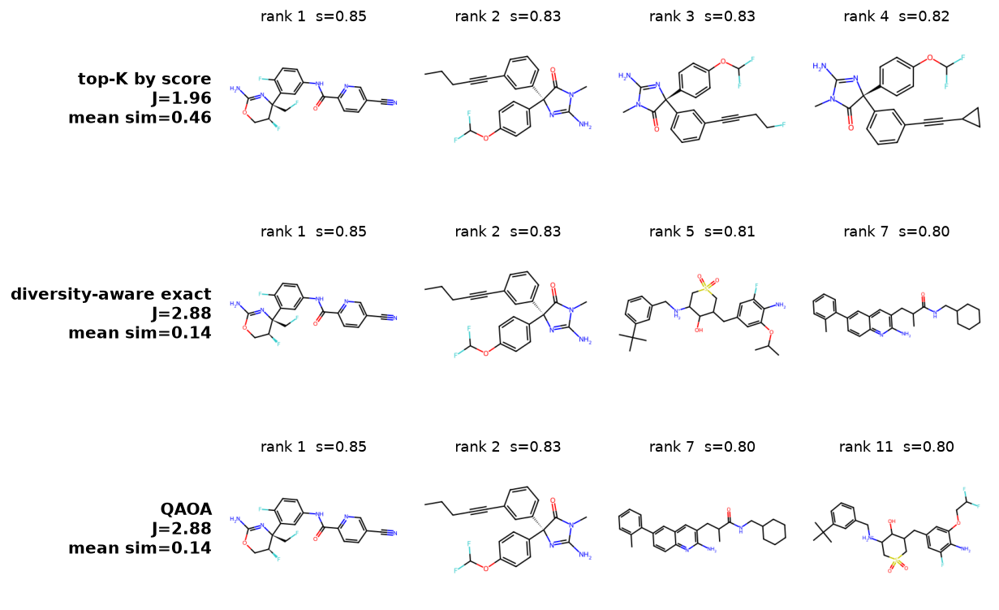

Score-only top-K picks three near-duplicate hydantoin analogues (mean similarity 0.46). QAOA and the exact diversity-aware solver both choose a chemically varied set (mean similarity ≈ 0.14, objective 2.88 vs 1.96); QAOA's set differs from the exact optimum by one molecule (ratio 0.999).

## 9. Summary

1. The full hybrid pipeline works end to end and is reproducible on a laptop CPU.
2. A quantum-kernel SVM reaches ROC-AUC ≈ 0.87 and EF@10% ≈ 2.1 (max 2.2), matching - but not beating - a classical RBF SVM on the same features.
3. The strongest model overall is a classical Random Forest on the full fingerprint (AUC 0.916); the bottleneck for the quantum model is compressing 2048 bits into 8 qubits.
4. Entanglement, deeper feature maps and more qubits (beyond 8) did not improve results.
5. The variational classifier is much slower and less accurate than the kernel approach at this scale.
6. VQE reproduces exact molecular ground-state energies for H2 and LiH, illustrating the chemistry route for future quantum drug discovery.
7. Diversity-aware selection of a batch of candidates is a genuinely non-trivial QUBO (score-only top-K reaches only 78-92 % of the optimum), and QAOA finds near-optimal batches, but random search with the same shots does equally well; QAOA's output distribution is no better than random sampling.
